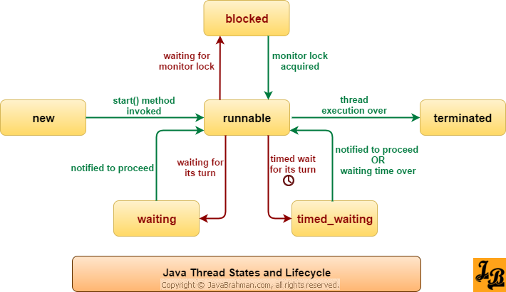
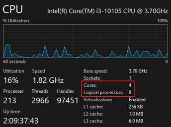

# 🧵 Threads: Hilos y Concurrencia

Los temas fueron tomados del curso de
[Máster Completo en Java de cero a experto 2025 (+178 hrs)](https://www.udemy.com/course/master-completo-java-de-cero-a-experto/learn/lecture/22747925#overview)
de Andrés Guzmán (Sección 25).

---

## 📘 ¿Qué son los hilos?

Un `hilo` (o `thread`) es la unidad más pequeña de ejecución dentro de un programa. Cada hilo tiene su propio flujo de
control, lo que permite que un `programa realice múltiples tareas de manera concurrente`.

> En términos simples: mientras un hilo realiza una tarea (por ejemplo, leer un archivo), otro puede ejecutar una
> tarea diferente (por ejemplo, procesar datos o atender una petición HTTP).

### ⚙️ Beneficios de usar hilos

- Mejor aprovechamiento del CPU en sistemas multinúcleo.
- Permite mantener aplicaciones responsivas (por ejemplo, evitar que la UI o el servidor se bloqueen).
- Facilita la ejecución concurrente de tareas independientes.

### ⚠️ Desventajas o retos

- Manejo de sincronización (evitar `race conditions` o inconsistencias de datos).
- Dificultad para depurar o reproducir errores.
- El uso excesivo de hilos puede saturar la memoria o el planificador del sistema operativo.

### 🔍 Características

- ` Entorno multihilo (multi-thread)`: la JVM es un entorno que soporta la ejecución de múltiples hilos dentro del mismo
  proceso, lo que permite que varias tareas avancen de forma concurrente.
- `Soporte de lenguaje`: Java ofrece soporte de hilos mediante la clase Thread y la interfaz Runnable. Además, la clase
  Object proporciona métodos básicos de coordinación (wait (), notify (), notifyAll ()).
- `Gestión y planificación`: en la práctica la JVM colabora con el sistema operativo para la planificación de hilos
  (modelo 1:1 en la mayoría de implementaciones). La JVM y el SO gestionan cuándo y en qué orden se ejecutan los hilos,
  así como prioridades y cambios de contexto.
- `Concurrencia vs paralelismo`: la ejecución concurrente permite que diferentes partes del programa progresen
  simultáneamente en el sentido lógico; el paralelismo (ejecución real al mismo tiempo) depende de disponer de múltiples
  núcleos de CPU.
- `Compartición de recursos`: los hilos de un mismo proceso comparten el heap y recursos del proceso (objetos, variables
  estáticas, ficheros), pero cada hilo tiene su propia pila (stack) y registro de ejecución (program counter).
- `Ligereza`: en comparación con procesos del sistema operativo, los hilos son más ligeros (menos overhead al crearlos y
  cambiarlos), lo que permite crear mayor concurrencia a menor coste.
- `Control y API básica`: Java dispone de métodos y operaciones para controlar hilos:
    - `start()` — inicia la ejecución en un nuevo hilo;
    - `run()` — contiene la lógica del hilo (no debe llamarse directamente si la intención es ejecutar en un hilo
      nuevo);
    - `sleep(long millis)` — pausa la ejecución del hilo actual (lanza InterruptedException);
    - `join()` — espera a que otro hilo termine;
    - `interrupt()` — señal para interrumpir la ejecución (cancelación cooperativa);
    - `isAlive()`, `setPriority(...)` y otros utilitarios.
- `Problemas a considerar`: el uso de hilos introduce retos como condiciones de carrera (race conditions), deadlocks y
  problemas de visibilidad de memoria. Se requieren mecanismos de sincronización (por ejemplo, synchronized, volatile,
  Lock, colecciones concurrentes) para evitarlos.
- `Buenas prácticas (resumen)`: preferir abstracciones de alto nivel (por ejemplo `ExecutorService`) sobre la gestión
  manual de Thread, minimizar el estado mutable compartido, y usar las utilidades de la concurrencia
  (java.util.concurrent) cuando sea posible.

### 🏭 Analogía de la Fábrica para Hilos en Java

Imagina que tienes una fábrica 🏭 (tu programa/proceso).

- El `Proceso (Programa)`: Es el edificio completo. Contiene todos los recursos compartidos,
  el almacén de herramientas (la memoria RAM compartida), y el plan de trabajo.
- El `Hilo (Thread)`: Es un `trabajador individual` dentro de la fábrica.
    - `Unidad de Ejecución`: El trabajador está realizando una tarea específica (cortar, ensamblar, pintar).
    - `Pila (Stack)`: Cada trabajador tiene su propia bandeja de herramientas y lista de instrucciones personales (la
      pila de memoria), que nadie más usa.
    - `Recursos Compartidos`: Todos los trabajadores (hilos) comparten el mismo almacén grande (la memoria heap y
      variables estáticas).
    - `Condición de Carrera`: Si dos trabajadores intentan tomar el último martillo del almacén o anotar el número
      de productos terminados al mismo tiempo sin coordinarse, habrá un error (inconsistencia).

En resumen:

| Componente de Java     | Analogía de la fábrica                          | Explicación                                                                                                                                                     |
|------------------------|-------------------------------------------------|-----------------------------------------------------------------------------------------------------------------------------------------------------------------|
| `Proceso (JVM)`        | El Edificio/Fábrica                             | Es el programa en ejecución. Contiene y gestiona todos los recursos.                                                                                            |
| `Hilos (Threads)`      | Trabajadores individuales                       | Las unidades de ejecución que realizan tareas. Son la parte activa del trabajo.                                                                                 |
| `Memoria Heap`         | El Almacén Central                              | Memoria `compartida` por todos los trabajadores (hilos). Contiene objetos, listas y variables de instancia. Aquí es donde ocurren las `condiciones de carrera`. |
| `Pila (Stack)`         | La Bandeja de Herramientas del Trabajador       | Memoria `privada` para cada hilo. Almacena variables locales y el rastro de llamadas a métodos. Lo que un trabajador tiene aquí no lo afecta a otro.            |
| `Métodos synchronized` | La Llave y el Candado Único                     | Un mecanismo que obliga a que `solo un trabajador` pueda entrar al almacén (recurso crítico) a la vez. El resto debe esperar.                                   |
| `Condición de Carrera` | Dos trabajadores peleando por el último recurso | Sucede cuando dos o más trabajadores intentan modificar el almacén central al mismo tiempo sin el uso de la Taquilla.                                           |

## 🧩 Creación de hilos en Java

En Java, los hilos están representados por la clase `Thread`. Existen dos formas principales de crearlos:

### ✅ 1. Extendiendo la clase Thread

````java

@Slf4j
public class MyThread extends Thread {
    @Override
    public void run() {
        log.info("Ejecutando hilo: {}", Thread.currentThread().getName());
    }

    public static void main(String[] args) {
        MyThread thread = new MyThread();
        thread.start(); // Inicia el hilo
    }
}
````

📌 Puntos clave:

- El método `run()` contiene la lógica del hilo.
- El método `start()` `crea un nuevo hilo del sistema operativo` y luego invoca `run()` en ese hilo.
- `Nunca` llames directamente a `run()`, ya que no se ejecutará en un nuevo hilo.

````bash
23:28:40.691 [Thread-0] INFO dev.magadiflo.app.threads.MyThread -- Ejecutando hilo: Thread-0
````

### ✅ 2. Implementando la interfaz Runnable

````java

@Slf4j
public class MyRunnable implements Runnable {
    @Override
    public void run() {
        log.info("Ejecutando hilo: {}", Thread.currentThread().getName());
    }

    public static void main(String[] args) {
        Thread thread = new Thread(new MyRunnable());
        thread.start();
    }
}
````

📌 Ventajas de usar Runnable:

- Permite heredar de otras clases, ya que Java no soporta herencia múltiple.
- Fomenta la separación de responsabilidades: la tarea (`Runnable`) y el hilo (`Thread`) son entidades distintas.

````bash
23:32:01.485 [Thread-0] INFO dev.magadiflo.app.threads.MyRunnable -- Ejecutando hilo: Thread-0 
````

### ⚡ Usando expresiones lambda (Java 8+)

````java

@Slf4j
public class MyLambdaThread {
    public static void main(String[] args) {
        Runnable task = () -> log.info("Ejecutando hilo con lambda: {}", Thread.currentThread().getName());

        Thread thread = new Thread(task);
        thread.start();
    }
}
````

````bash
23:34:23.314 [Thread-0] INFO dev.magadiflo.app.threads.MyLambdaThread -- Ejecutando hilo con lambda: Thread-0 
````

## 🚫 ¿Usaremos `Thread` directamente en proyectos reales?

Aprender sobre hilos, sincronización y concurrencia en Java puede parecer complejo al inicio, especialmente cuando
se estudian temas como `Thread`, `Runnable`, `wait()`, `notify()` o `synchronized`. Sin embargo, es importante saber
que `en proyectos reales rara vez creamos y gestionamos hilos de forma manual`.

Estos conceptos se enseñan para `entender cómo funciona la concurrencia desde su base`, no para implementarlos
directamente en producción.

### 🧵 ¿Por qué no creamos hilos manualmente?

Cuando estamos aprendiendo, es común ver ejemplos como:

````bash
Thread t = new Thread(() -> {
    System.out.println("Ejecutando tarea en un hilo...");
});
t.start();
````

O incluso usar la interfaz Runnable:

````bash
class MiHilo implements Runnable {
    public void run() {
        System.out.println("Ejecutando tarea...");
    }
}
new Thread(new MiHilo()).start();
````

Estos ejemplos son `didácticos` y te ayudan a entender:

- Cómo se crea un hilo.
- Qué hace el método `start()`.
- Cómo se ejecuta el método `run()`.
- Qué implica sincronizar el acceso a recursos compartidos.

Pero en entornos reales, esto no escala y puede traer problemas graves:

| Problema                        | Explicación                                                                                     |
|:--------------------------------|:------------------------------------------------------------------------------------------------|
| 🧩 **Complejidad de gestión**   | Manejar el ciclo de vida de muchos hilos (inicio, finalización, errores) se vuelve difícil.     |
| ⚠️ **Fugas de recursos**        | Crear hilos sin control puede saturar la JVM o el sistema operativo.                            |
| 🚫 **Falta de escalabilidad**   | Crear un hilo por tarea es inviable en sistemas con cientos de miles de peticiones simultáneas. |
| 🧠 **Mantenimiento complicado** | El código se vuelve difícil de leer, depurar y extender.                                        |

### ✅ ¿Qué usamos realmente en proyectos modernos?

Java proporciona `abstracciones de más alto nivel` que gestionan los hilos por nosotros y hacen que el código sea más
legible, eficiente y seguro.

### 🔹 `ExecutorService` (desde Java 5)

En lugar de crear manualmente los hilos, definimos un `pool (grupo) de hilos que se reutilizan`.

```bash
ExecutorService executor = Executors.newFixedThreadPool(4); // 4 hilos
executor.submit(() -> {
    // tarea concurrente
});
executor.shutdown();
````

### 🔹 `ForkJoinPool` (desde Java 7)

Ideal para tareas `divisibles y paralelizables`. Utiliza el algoritmo `work-stealing` para balancear carga entre hilos.

### 🔹 `CompletableFuture` (desde Java 8)

Permite ejecutar tareas de forma `asíncrona` y `no bloqueante`, encadenando acciones.

```bash
CompletableFuture.supplyAsync(() -> fetchData())
                 .thenApply(data -> process(data))
                 .thenAccept(result -> log(result));
````

### 🔹 `Virtual Threads` (desde Java 21+)

Los `Virtual Threads` representan una nueva era en la concurrencia de Java. Permiten crear `millones de hilos ligeros`,
administrados por la JVM (no por el sistema operativo).

```bash
try (var executor = Executors.newVirtualThreadPerTaskExecutor()) {
    for (int i = 0; i < 5; i++) {
        int id = i;
        executor.submit(() -> {
            System.out.println("🌱 Ejecutando tarea " + id + " en " + Thread.currentThread());
        });
    }
}
````

- Se crean y destruyen casi instantáneamente.
- Permiten manejar miles o millones de tareas concurrentes.
- Simplifican la asincronía sin necesidad de frameworks complejos.

### 🔹 Programación Reactiva (`Reactor`, `RxJava`)

Basada en flujos de datos `no bloqueantes`. Ideal para sistemas altamente concurrentes y escalables.

```bash
Mono.just("dato")
    .map(this::procesar)
    .subscribe(this::mostrar);
````

### 🔹 Frameworks y contenedores (`Spring`, `Jakarta EE`)

En aplicaciones web, los hilos son gestionados por el contenedor de servlet o el framework. El desarrollador no crea
hilos directamente, sino que define tareas que el framework ejecuta en su contexto.

### 🧭 3. En resumen

| Nivel                       | Enfoque                                           | Uso común                                                 |
|:----------------------------|:--------------------------------------------------|:----------------------------------------------------------|
| 🧱 **Bajo nivel**           | `Thread`, `Runnable`, `wait()`, `notify()`        | Aprendizaje, ejemplos, simulaciones.                      |
| ⚙️ **Intermedio**           | `ExecutorService`, `Future`, `Callable`           | Aplicaciones backend, APIs concurrentes.                  |
| 🚀 **Alto nivel / moderno** | `CompletableFuture`, `Virtual Threads`, `WebFlux` | Sistemas escalables, microservicios, asincronía avanzada. |

### 🧠 Conclusión

> Aprender a crear hilos con `Thread` y `Runnable` es fundamental para entender cómo funciona la concurrencia en Java.
> Pero en proyectos reales, `no gestionamos hilos manualmente`: utilizamos herramientas más robustas como
> `ExecutorService`, `CompletableFuture`, `ForkJoinPool` o `frameworks reactivos` que gestionan los hilos por nosotros.

Esta sección busca dar tranquilidad al lector: los conceptos de bajo nivel que está aprendiendo son esenciales para
comprender el funcionamiento interno, pero en la práctica se aplican soluciones más intuitivas y seguras.

## 🧵 Ciclo de Vida de un Hilo en Java

El `ciclo de vida de un hilo` (`Thread Life Cycle`) describe los diferentes `estados por los que pasa un hilo` desde
su creación hasta su finalización.

Comprender estos estados es esencial para sincronizar correctamente la ejecución de tareas concurrentes y evitar
problemas como `deadlocks` o `race conditions`.

### 🔄 Estados del Ciclo de Vida

La clase `Thread` en Java define un `enum` llamado `State`, que representa los seis posibles estados en los que un
hilo puede encontrarse durante su ciclo de vida. Cada estado refleja el comportamiento del hilo en tiempo de ejecución,
y un hilo `solo puede estar en un estado a la vez`.

Estos estados son:

- 🆕 NEW
- 🏃 RUNNABLE
- 🚧 BLOCKED
- ⏳ WAITING
- ⏱️ TIMED_WAITING
- ✅ TERMINATED

📌 Podemos acceder al estado actual de un hilo mediante el método `getState()`.

[](https://www.javabrahman.com/corejava/understanding-thread-life-cycle-thread-states-in-java-tutorial-with-examples/)

### `1. NEW`

El hilo ha sido creado, pero aún no se ha iniciado con `start()`.

````java

@Slf4j
public class NewState {
    public static void main(String[] args) {
        Runnable task = () -> log.info("Ejecutando hilo con lambda: {}", Thread.currentThread().getName());
        Thread thread = new Thread(task);
        log.info("Estado: {}", thread.getState());
    }
}
````

Como no se ha iniciado el hilo mencionado, el método `thread.getState()` imprime:

````bash
19:46:15.711 [main] INFO dev.magadiflo.app.lifecycle.NewState -- Estado: NEW
````

### `2. RUNNABLE`

- Cuando creamos un nuevo hilo y llamamos al método `start()`, este pasa del estado `NEW` a `RUNNABLE`.
- Los hilos en este estado están en ejecución o listos para ejecutarse, pero esperan la asignación de recursos del
  sistema.
- En un entorno multihilo, el `Programador de Hilos [Thread-Scheduler]` (que forma parte de la JVM) asigna un tiempo
  fijo a cada hilo. Por lo tanto, se ejecuta durante un tiempo determinado y luego cede el control a otros hilos
  `RUNNABLE`.
- Hay dos puntos importantes a tener en cuenta con respecto al estado ejecutable:
    1. Aunque el hilo entra en estado `runnable` inmediatamente al invocar el método `start()`, no es necesario que
       comience a ejecutarse inmediatamente. Un hilo se ejecuta cuando el procesador puede ejecutar la lógica contenida
       en su método `run()`. Si la lógica del hilo necesita algún recurso que no esté disponible, el hilo espera a que
       el recurso esté disponible.
    2. En segundo lugar, un hilo en estado `runnable` puede ejecutarse durante un tiempo y luego bloquearse por un
       `blocked` de monitor, o entrar en los estados `waiting` o `timed_wainting` mientras espera la oportunidad/tiempo
       para volver a entrar en estado `runnable`.

````java

@Slf4j
public class RunnableState {
    public static void main(String[] args) throws InterruptedException {
        Runnable task = () -> {
            while (!Thread.currentThread().isInterrupted()) {
                log.info("Simulando trabajo...");
            }
        };
        Thread thread = new Thread(task);
        thread.start();

        Thread.sleep(100); // Dar tiempo para que inicie
        log.info("Estado: {}", thread.getState());
        thread.interrupt();
    }
}
````

````bash
...
19:48:02.240 [Thread-0] INFO dev.magadiflo.app.lifecycle.RunnableState -- Simulando trabajo...
19:48:02.240 [Thread-0] INFO dev.magadiflo.app.lifecycle.RunnableState -- Simulando trabajo...
19:48:02.221 [main] INFO dev.magadiflo.app.lifecycle.RunnableState -- Estado: RUNNABLE
````

### `3. BLOCKED`

- El hilo intenta acceder a un recurso bloqueado por otro hilo (por ejemplo, un monitor synchronized).
- Se mantiene en este estado hasta que el recurso esté disponible.
- Un hilo está en estado `BLOCKED` cuando no puede ejecutarse. Entra en este estado cuando espera un bloqueo de monitor
  e intenta acceder a una sección de código bloqueada por otro hilo.

````java

@Slf4j
public class BlockedState {

    private static final Object lock = new Object();

    public static void main(String[] args) throws InterruptedException {
        Runnable task1 = () -> {
            synchronized (lock) {
                try {
                    Thread.sleep(5000); // Mantener el lock
                } catch (InterruptedException e) {
                    Thread.currentThread().interrupt();
                }
            }
        };

        Runnable task2 = () -> {
            synchronized (lock) { // Intentará adquirir el lock
                log.info("Thread 2 obtuvo el lock");
            }
        };

        Thread thread1 = new Thread(task1);
        Thread thread2 = new Thread(task2);

        thread1.start();
        Thread.sleep(100); // Asegurar que el thread1 tome el lock

        thread2.start();
        Thread.sleep(100); // Dar tiempo para que thread2 intente el lock

        log.info("Estado thread2: {}", thread2.getState());
    }
}
````

````bash
16:45:35.437 [main] INFO dev.magadiflo.app.lifecycle.BlockedState -- Estado thread2: BLOCKED
16:45:40.219 [Thread-1] INFO dev.magadiflo.app.lifecycle.BlockedState -- Thread 2 obtuvo el lock
````

### `4. WAITING`

- El hilo está `esperando indefinidamente` a que otro hilo lo notifique.
- Se entra en este estado con métodos como `Object.wait()`, `Thread.join()` o `LockSupport.park()` sin tiempo límite.

````java

@Slf4j
public class WaitingState {

    private static final Object lock = new Object();

    public static void main(String[] args) throws InterruptedException {
        Runnable task = () -> {
            synchronized (lock) {
                try {
                    lock.wait(); // Espera indefinida
                } catch (InterruptedException e) {
                    Thread.currentThread().interrupt();
                }
            }
        };
        Thread thread = new Thread(task);
        thread.start();
        Thread.sleep(100); // Dar tiempo para que entre en wait

        log.info("Estado: {}", thread.getState());

        // Despertar el hilo
        synchronized (lock) {
            lock.notify();
        }
    }
}
````

````bash
20:18:24.231 [main] INFO dev.magadiflo.app.lifecycle.WaitingState -- Estado: WAITING
````

#### 📝 ¿Cómo funciona este ejemplo?

1. El hilo thread entra en el bloque `synchronized(lock)` y adquiere el monitor del objeto `lock`.
2. Al ejecutar `lock.wait()`, **el hilo libera el monitor y pasa al estado `WAITING`**, esperando una notificación.
3. El hilo principal (`main`), después de `Thread.sleep(100)`, consulta el estado del hilo y muestra `WAITING` en el
   log.
4. Luego, el hilo principal entra en `synchronized(lock)`, adquiere el monitor que quedó libre y ejecuta
   `lock.notify()`,
   notificando al hilo que estaba esperando.

#### ¿Por qué puede entrar en ese último bloque si lock estaba tomado?

Porque cuando el hilo ejecuta `lock.wait()`, libera el monitor de `lock`. Por eso, el hilo principal puede adquirirlo y
llamar a `notify()`.

> **Importante:** `notify()` no libera inmediatamente el monitor ni hace que el hilo notificado continúe ejecutándose
> dentro del bloque `synchronized`. El hilo notificado debe esperar a que el hilo principal salga del bloque y libere
> el monitor para poder continuar.

### `5. TIMED_WAITING`

- Similar a `WAITING`, pero el hilo `espera por un tiempo determinado`.
- Un hilo espera a que otro hilo realice una acción específica dentro de un tiempo determinado.
- Según `JavaDocs`, hay cinco maneras de poner un hilo en estado `TIMED_WAITING`:
    - `thread.sleep(long millis)`
    - `wait(int timeout)` or `wait(int timeout, int nanos)`
    - `thread.join(long millis)`
    - `LockSupport.parkNanos`
    - `LockSupport.parkUntil`

````java

@Slf4j
public class TimedWaitingState {
    public static void main(String[] args) throws InterruptedException {
        Thread thread = new Thread(() -> {
            try {
                Thread.sleep(5000); // Dormir por 5 segundos
            } catch (InterruptedException e) {
                Thread.currentThread().interrupt();
            }
        });

        thread.start();
        Thread.sleep(100); // Dar tiempo para que entre al sleep

        log.info("Estado: {}", thread.getState());
    }
}
````

````bash
20:27:34.407 [main] INFO dev.magadiflo.app.lifecycle.TimedWaitingState -- Estado: TIMED_WAITING
````

### `6. TERMINATED`

- El hilo ha `finalizado su ejecución`.
- Puede haber terminado normalmente o por una excepción no controlada.

````java

@Slf4j
public class TerminatedState {
    public static void main(String[] args) throws InterruptedException {
        Thread thread = new Thread(() -> {
            log.info("Hilo ejecutándose...");
        });
        thread.start();
        thread.join(); // Espera a que termine
        log.info("Estado: {}", thread.getState());
    }
}
````

````bash
20:32:15.870 [Thread-0] INFO dev.magadiflo.app.lifecycle.TerminatedState -- Hilo ejecutándose...
20:32:15.878 [main] INFO dev.magadiflo.app.lifecycle.TerminatedState -- Estado: TERMINATED
````

## 🔔 Métodos wait (), notify () y notifyAll () en Java

Los métodos `wait()`, `notify()` y `notifyAll()` son parte de la clase base `java.lang.Object` y forman el núcleo de
la comunicación entre hilos (`thread communication`).

Estos métodos permiten que los hilos `sincronicen su ejecución y cooperen` cuando comparten un mismo recurso.

### 📌 ¿Por qué están en Object y no en Thread?

Porque la sincronización en Java se basa en `monitores asociados a objetos`, no a hilos. Todo objeto puede actuar como
un monitor, por eso los métodos están definidos en `Object`.

### 🧩 Concepto General

Cuando varios hilos acceden a un recurso compartido (por ejemplo, una variable o una lista), puede ser necesario que
uno de ellos espere hasta que otro hilo cambie el estado del recurso.

Aquí es donde intervienen estos tres métodos, que trabajan dentro de bloques sincronizados (`synchronized`) para
coordinar la ejecución.

### ⚙️ Descripción de los Métodos

| Método                  | Descripción                                                                                                                                                                            | Estado del Hilo |
|:------------------------|:---------------------------------------------------------------------------------------------------------------------------------------------------------------------------------------|:----------------|
| `wait()` ⏳             | Hace que el hilo `libere el monitor` y entre en estado de espera (`WAITING`). El hilo no puede continuar hasta que otro hilo invoque `notify()` o `notifyAll()` sobre el mismo objeto. | `WAITING`       |
| `wait(long timeout)` ⏰ | Igual que `wait()`, pero el hilo esperará **solo el tiempo especificado** (en milisegundos).                                                                                           | `TIMED_WAITING` |
| `notify()` 🔔           | Despierta `un solo hilo` que esté esperando sobre el monitor del objeto. No garantiza cuál hilo será despertado si hay varios en espera.                                               | —               |
| `notifyAll()` 📢        | Despierta a `todos los hilos` que están esperando sobre el mismo objeto; solo uno continuará cuando obtenga el bloqueo.                                                                | —               |

⚠️ Todos estos métodos deben ser llamados dentro de un bloque sincronizado (`synchronized`), de lo contrario lanzarán
una excepción `IllegalMonitorStateException`.

### 💻 Ejemplo Práctico

Veamos un ejemplo clásico de `Productor–Consumidor`, donde un hilo produce datos y otro los consume usando `wait()` y`
notify()`.

````java

@Slf4j
public class SharedResource {
    private boolean available = false;

    public synchronized void produce(int count) {
        while (this.available) {
            try {
                log.info("produce - wait #{}", count);
                wait(); // Espera hasta que el recurso sea consumido
            } catch (InterruptedException e) {
                Thread.currentThread().interrupt();
            }
        }
        log.info("Produciendo recurso #{}", count);
        this.available = true;
        notify(); // Despierta al consumidor
    }

    public synchronized void consume(int count) {
        while (!this.available) {
            try {
                log.info("consume - wait #{}", count);
                wait(); // Espera hasta que haya un recurso disponible
            } catch (InterruptedException e) {
                Thread.currentThread().interrupt();
            }
        }
        log.info("Consumiendo recurso #{}", count);
        this.available = false;
        notify(); // Despierta al productor
    }

    public static void main(String[] args) {
        SharedResource resource = new SharedResource();

        Thread producer = new Thread(() -> {
            for (int i = 0; i < 5; i++) {
                resource.produce(i);
            }
        });

        Thread consumer = new Thread(() -> {
            for (int i = 0; i < 5; i++) {
                resource.consume(i);
            }
        });

        producer.start();
        consumer.start();
    }
}
````

### 🔐 ¿Por qué los métodos son synchronized?

Los métodos `produce()` y `consume()` están marcados como `synchronized` porque:

- Los métodos `wait()` y `notify()` `solo pueden invocarse dentro de un bloque sincronizado`, es decir, cuando el hilo
  posee el monitor del objeto.
- Esto garantiza que el acceso a la variable compartida `available` sea seguro y consistente entre hilos.

### 🧵 ¿Qué significa que estén sincronizados?

Cuando un hilo entra a un método `synchronized`, bloquea el monitor del objeto (`SharedResource` en este caso).
Esto implica:

- `Ningún otro hilo` puede ejecutar otro método `synchronized` sobre el mismo objeto hasta que el monitor sea liberado.
- El monitor se libera cuando:
    - El método termina.
    - El hilo llama a `wait()` → esto libera el monitor temporalmente.

### 🔄 Flujo detallado de coordinación entre productor y consumidor

1. El productor produce `#0`
    - `available = false` → entra directo a la lógica de producción.
    - Produce y cambia `available = true`.
    - Llama a `notify()` → despierta al consumidor.
2. El productor intenta producir `#1`
    - `available = true` → entra al `while`, ejecuta `wait()`.
    - Se bloquea esperando que el consumidor consuma.
3. El consumidor consume `#0`
    - `available = true` → entra directo a la lógica de consumo.
    - Consume y cambia `available = false`.
    - Llama a `notify()` → despierta al productor.
4. El consumidor intenta consumir `#1`
    - `available = false` → entra al `while`, ejecuta `wait()`.
    - Se bloquea esperando que el productor produzca.

📢 Este patrón se repite

- Cada hilo entra a `wait()` antes de que el otro haya terminado su trabajo.
- Esto ocurre porque ambos hilos están en bucles for, y el planificador puede hacer que uno avance más rápido.
- El `wait()` libera el monitor, permitiendo que el otro hilo entre y lo despierte con `notify()`.

````bash
00:37:23.203 [Thread-0] INFO dev.magadiflo.app.threadcoordination.SharedResource -- Produciendo recurso #0
00:37:23.209 [Thread-0] INFO dev.magadiflo.app.threadcoordination.SharedResource -- produce - wait #1
00:37:23.210 [Thread-1] INFO dev.magadiflo.app.threadcoordination.SharedResource -- Consumiendo recurso #0
00:37:23.210 [Thread-1] INFO dev.magadiflo.app.threadcoordination.SharedResource -- consume - wait #1
00:37:23.210 [Thread-0] INFO dev.magadiflo.app.threadcoordination.SharedResource -- Produciendo recurso #1
00:37:23.210 [Thread-0] INFO dev.magadiflo.app.threadcoordination.SharedResource -- produce - wait #2
00:37:23.210 [Thread-1] INFO dev.magadiflo.app.threadcoordination.SharedResource -- Consumiendo recurso #1
00:37:23.210 [Thread-1] INFO dev.magadiflo.app.threadcoordination.SharedResource -- consume - wait #2
00:37:23.210 [Thread-0] INFO dev.magadiflo.app.threadcoordination.SharedResource -- Produciendo recurso #2
00:37:23.210 [Thread-0] INFO dev.magadiflo.app.threadcoordination.SharedResource -- produce - wait #3
00:37:23.210 [Thread-1] INFO dev.magadiflo.app.threadcoordination.SharedResource -- Consumiendo recurso #2
00:37:23.210 [Thread-1] INFO dev.magadiflo.app.threadcoordination.SharedResource -- consume - wait #3
00:37:23.210 [Thread-0] INFO dev.magadiflo.app.threadcoordination.SharedResource -- Produciendo recurso #3
00:37:23.210 [Thread-0] INFO dev.magadiflo.app.threadcoordination.SharedResource -- produce - wait #4
00:37:23.210 [Thread-1] INFO dev.magadiflo.app.threadcoordination.SharedResource -- Consumiendo recurso #3
00:37:23.210 [Thread-1] INFO dev.magadiflo.app.threadcoordination.SharedResource -- consume - wait #4
00:37:23.210 [Thread-0] INFO dev.magadiflo.app.threadcoordination.SharedResource -- Produciendo recurso #4
00:37:23.210 [Thread-1] INFO dev.magadiflo.app.threadcoordination.SharedResource -- Consumiendo recurso #4
````

🧩 Alternativas modernas
> En aplicaciones modernas, es más recomendable usar clases del paquete `java.util.concurrent` como `ReentrantLock`,
> `Condition`, `BlockingQueue` o `CountDownLatch`, que ofrecen un control más claro y seguro sobre la concurrencia.

## 🧵 Creando Hilos Heredando de la Clase Thread

En la lección `“Creación de hilos en Java”`, vimos de manera general cómo se puede crear un hilo heredando de la
clase `Thread`.

En esta sección profundizaremos un poco más, agregando un constructor personalizado para asignar un nombre al hilo, y
observando su estado antes y después de iniciar la ejecución.

### 💻 Ejemplo: hilo con nombre personalizado

````java

@Slf4j
public class MyThread extends Thread {

    public MyThread(String name) {
        super(name); // Asigna el nombre al hilo
    }

    @Override
    public void run() {
        log.info("Inicia ejecución del hilo {}", Thread.currentThread().getName());

        IntStream.range(0, 10)
                .forEach(value -> log.info("{}, {}", value, Thread.currentThread().getName()));

        log.info("Fin del hilo {}", Thread.currentThread().getName());
    }

    public static void main(String[] args) {
        Thread thread = new MyThread("hilo-1");
        log.info("{}", thread.getState()); // Estado inicial
    }
}
````

#### 📌 Estado del hilo antes de iniciar

Al ejecutar la clase anterior, la salida mostrará el estado `NEW`, ya que el hilo ha sido creado pero aún no iniciado
con el método `start()`:

````bash
19:21:32.070 [main] INFO dev.magadiflo.app.threads.MyThread -- NEW 
````

- El objeto `Thread` existe, pero su método `run()` todavía no se ha ejecutado.
- El hilo se encuentra en el estado inicial (`NEW`) del ciclo de vida.

#### ▶️ Iniciando el hilo con start ()

Ahora agregamos la llamada a `start()` para iniciar la ejecución del hilo:

````java

@Slf4j
public class MyThread extends Thread {
    /* code */
    public static void main(String[] args) {
        Thread thread = new MyThread("hilo-1");
        thread.start();                     // Inicia el hilo
        log.info("{}", thread.getState());
    }
}
````

Observemos la salida de la ejecución anterior:

````bash
19:22:59.029 [main] INFO dev.magadiflo.app.threads.MyThread -- RUNNABLE
19:22:59.029 [hilo-1] INFO dev.magadiflo.app.threads.MyThread -- Inicia ejecución del hilo hilo-1
19:22:59.036 [hilo-1] INFO dev.magadiflo.app.threads.MyThread -- 0, hilo-1
19:22:59.036 [hilo-1] INFO dev.magadiflo.app.threads.MyThread -- 1, hilo-1
19:22:59.036 [hilo-1] INFO dev.magadiflo.app.threads.MyThread -- 2, hilo-1
19:22:59.036 [hilo-1] INFO dev.magadiflo.app.threads.MyThread -- 3, hilo-1
19:22:59.036 [hilo-1] INFO dev.magadiflo.app.threads.MyThread -- 4, hilo-1
19:22:59.036 [hilo-1] INFO dev.magadiflo.app.threads.MyThread -- 5, hilo-1
19:22:59.036 [hilo-1] INFO dev.magadiflo.app.threads.MyThread -- 6, hilo-1
19:22:59.036 [hilo-1] INFO dev.magadiflo.app.threads.MyThread -- 7, hilo-1
19:22:59.036 [hilo-1] INFO dev.magadiflo.app.threads.MyThread -- 8, hilo-1
19:22:59.036 [hilo-1] INFO dev.magadiflo.app.threads.MyThread -- 9, hilo-1
19:22:59.036 [hilo-1] INFO dev.magadiflo.app.threads.MyThread -- Fin del hilo hilo-1
````

- El estado `RUNNABLE` se imprime desde el hilo principal (`main`) justo después de llamar a `start()`.
- El hilo `hilo-1` comienza su ejecución de forma `asíncrona`, imprimiendo su contenido en paralelo.
- El nombre del hilo (`hilo-1`) se asigna mediante el constructor y se refleja en los logs.

Esto demuestra cómo `dos hilos pueden ejecutarse de forma concurrente` dentro del mismo proceso.

🧠 Nota técnica
> El estado `RUNNABLE` no significa que el hilo esté ejecutándose activamente en ese instante. Indica que el hilo está
> listo para ejecutarse y ha sido entregado al planificador del sistema operativo, quien decidirá cuándo asignarle
> tiempo de CPU. Esta distinción es importante para evitar confusiones entre estar “activo” y estar “listo”.

### 🧵 Ejecución paralela de múltiples hilos

En esta sección agregamos un segundo hilo y ejecutamos la clase principal para observar cómo se comportan ambos hilos
en tiempo de ejecución.

````java

@Slf4j
public class MyThread extends Thread {
    /* code */
    public static void main(String[] args) {
        Thread thread1 = new MyThread("hilo-1");
        thread1.start();

        Thread thread2 = new MyThread("hilo-2");
        thread2.start();

        log.info("{}", thread1.getState());
        log.info("{}", thread2.getState());
    }
}
````

#### 🔍 ¿Se ejecutan realmente en paralelo?

Sí. Aunque la salida parezca secuencial, los hilos `hilo-1` y `hilo-2` se están `ejecutando en paralelo`, gracias a que
los procesadores modernos tienen `múltiples núcleos`.

````bash
19:28:49.497 [main] INFO dev.magadiflo.app.threads.MyThread -- RUNNABLE
19:28:49.497 [hilo-1] INFO dev.magadiflo.app.threads.MyThread -- Inicia ejecución del hilo hilo-1
19:28:49.497 [hilo-2] INFO dev.magadiflo.app.threads.MyThread -- Inicia ejecución del hilo hilo-2
19:28:49.503 [main] INFO dev.magadiflo.app.threads.MyThread -- RUNNABLE
19:28:49.505 [hilo-1] INFO dev.magadiflo.app.threads.MyThread -- 0, hilo-1
19:28:49.505 [hilo-1] INFO dev.magadiflo.app.threads.MyThread -- 1, hilo-1
19:28:49.505 [hilo-1] INFO dev.magadiflo.app.threads.MyThread -- 2, hilo-1
19:28:49.505 [hilo-1] INFO dev.magadiflo.app.threads.MyThread -- 3, hilo-1
19:28:49.505 [hilo-1] INFO dev.magadiflo.app.threads.MyThread -- 4, hilo-1
19:28:49.505 [hilo-1] INFO dev.magadiflo.app.threads.MyThread -- 5, hilo-1
19:28:49.505 [hilo-1] INFO dev.magadiflo.app.threads.MyThread -- 6, hilo-1
19:28:49.505 [hilo-1] INFO dev.magadiflo.app.threads.MyThread -- 7, hilo-1
19:28:49.505 [hilo-1] INFO dev.magadiflo.app.threads.MyThread -- 8, hilo-1
19:28:49.505 [hilo-1] INFO dev.magadiflo.app.threads.MyThread -- 9, hilo-1
19:28:49.505 [hilo-1] INFO dev.magadiflo.app.threads.MyThread -- Fin del hilo hilo-1
19:28:49.508 [hilo-2] INFO dev.magadiflo.app.threads.MyThread -- 0, hilo-2
19:28:49.508 [hilo-2] INFO dev.magadiflo.app.threads.MyThread -- 1, hilo-2
19:28:49.508 [hilo-2] INFO dev.magadiflo.app.threads.MyThread -- 2, hilo-2
19:28:49.508 [hilo-2] INFO dev.magadiflo.app.threads.MyThread -- 3, hilo-2
19:28:49.508 [hilo-2] INFO dev.magadiflo.app.threads.MyThread -- 4, hilo-2
19:28:49.508 [hilo-2] INFO dev.magadiflo.app.threads.MyThread -- 5, hilo-2
19:28:49.508 [hilo-2] INFO dev.magadiflo.app.threads.MyThread -- 6, hilo-2
19:28:49.509 [hilo-2] INFO dev.magadiflo.app.threads.MyThread -- 7, hilo-2
19:28:49.509 [hilo-2] INFO dev.magadiflo.app.threads.MyThread -- 8, hilo-2
19:28:49.509 [hilo-2] INFO dev.magadiflo.app.threads.MyThread -- 9, hilo-2
19:28:49.509 [hilo-2] INFO dev.magadiflo.app.threads.MyThread -- Fin del hilo hilo-2
````

⚠️ Importante
> No debemos confundir concurrencia con paralelismo.
>
> - `Concurrencia`: varios hilos comparten tiempo de CPU, pero no necesariamente se ejecutan simultáneamente.
> - `Paralelismo`: varios hilos o procesos se ejecutan realmente al mismo tiempo en diferentes núcleos físicos.

#### 🧠 ¿Qué significa esto?

- En sistemas con `un solo núcleo`, los hilos se ejecutan de forma `concurrente`, alternando su ejecución.
- En sistemas con `múltiples núcleos`, los hilos pueden ejecutarse `realmente en paralelo`, cada uno en un núcleo
  distinto.

#### 🧠 ¿Qué son los cores y los logical processors?

| Término                | Definición breve                                                                                                                                                                                    |
|------------------------|-----------------------------------------------------------------------------------------------------------------------------------------------------------------------------------------------------|
| `Core (núcleo físico)` | Unidad física de procesamiento dentro del CPU. Cada core puede ejecutar un hilo a la vez.                                                                                                           |
| `Logical processor`    | Unidad lógica que el sistema operativo ve como procesador. Puede ser igual o mayor al número de cores si hay Hyper-Threading. Permite que cada núcleo físico maneje dos hilos de forma intercalada. |

### 🖥️ Características del CPU de ejemplo

Podemos ver esta información desde el `Administrador de tareas de Windows`, pestaña `Rendimiento` → `CPU`,
o desde la terminal de `Git Bash`.



````bash
magadiflo@SysEngJava MINGW64 ~
$ grep "cpu cores" /proc/cpuinfo | uniq
cpu cores       : 4

magadiflo@SysEngJava MINGW64 ~
$ grep "processor" /proc/cpuinfo | wc -l
8 
````

Esto indica:

- `4` núcleos físicos (`cores`)
- `8` procesadores lógicos (`logical processors`)
- El CPU soporta `Hyper-Threading` (o SMT)

💡 Interpretación:
> Tu CPU tiene 4 núcleos, y cada núcleo puede manejar 2 hilos simultáneamente.
> Así, el sistema operativo “ve” 8 procesadores lógicos y puede distribuir tareas entre ellos.

#### ⚙️ ¿Qué es Hyper-Threading (HT) o SMT?

Tecnología que permite que cada núcleo físico maneje `dos hilos simultáneamente`, alternando entre ellos de forma
eficiente.

- No ejecuta ambos hilos `exactamente al mismo tiempo`, pero los intercala tan rápido que `parece simultáneo`.
- Mejora el rendimiento en tareas multihilo al `maximizar el uso del núcleo`.

#### 🧪 Ejemplo de paralelismo real

Si ejecutamos 3 procesos independientes en una máquina con 4 núcleos físicos:

- Cada proceso puede ser asignado a un núcleo distinto.
- Los 3 procesos se ejecutan `realmente en paralelo`, sin alternancia.
- El cuarto núcleo queda libre o disponible para otras tareas.

### ✅ Conclusión

En sistemas modernos con múltiples núcleos y soporte para `Hyper-Threading`, los hilos pueden ejecutarse en paralelo
o de forma intercalada, dependiendo de la carga y asignación del sistema operativo.

Este conocimiento es clave para entender cómo se comportan los hilos en la práctica, y por qué la concurrencia en Java
puede aprovechar el hardware subyacente para mejorar el rendimiento.

## 🧵 Creando hilos implementando la interfaz Runnable

En la lección `"Creación de hilos en Java"`, vimos cómo crear un hilo implementando la interfaz `Runnable`.
En esta sección profundizaremos en esta técnica, asignando nombres personalizados a los hilos y observando su
ejecución en paralelo.

### 💻 Ejemplo: implementación de Runnable con múltiples hilos

Modificamos la clase que implementa la interfaz `Runnable`. Luego, creamos tres hilos y a cada uno le asignamos un
nombre. Dentro de la implementación del método `run()` podemos obtener el hilo actual utilizando el método estático
`Thread.currentThread()` de la clase `Thread`, y a partir de él obtener su nombre con `getName()`.

````java

@Slf4j
public class MyRunnable implements Runnable {
    @Override
    public void run() {
        log.info("Inicia ejecución del hilo {}", Thread.currentThread().getName());

        IntStream.range(0, 3)
                .forEach(value -> {
                    try {
                        Thread.sleep((long) (Math.random() * 1000));
                        log.info("realizando tarea... índice: {}, hilo actual: {}", value, Thread.currentThread().getName());
                    } catch (InterruptedException e) {
                        Thread.currentThread().interrupt();
                    }
                });

        log.info("Fin del hilo {}", Thread.currentThread().getName());
    }

    public static void main(String[] args) {
        Thread thread1 = new Thread(new MyRunnable(), "hilo-1");
        Thread thread2 = new Thread(new MyRunnable(), "hilo-2");
        Thread thread3 = new Thread(new MyRunnable(), "hilo-3");

        thread1.start();
        thread2.start();
        thread3.start();
    }
}
````

Al ejecutar la clase anterior, veremos que los tres hilos se ejecutan en paralelo. Además, gracias al uso de
`Thread.sleep()` con tiempos aleatorios, se genera una especie de “competencia” entre ellos para ver cuál finaliza
primero.

````bash
23:17:19.121 [hilo-1] INFO dev.magadiflo.app.threads.MyRunnable -- Inicia ejecución del hilo hilo-1
23:17:19.121 [hilo-3] INFO dev.magadiflo.app.threads.MyRunnable -- Inicia ejecución del hilo hilo-3
23:17:19.121 [hilo-2] INFO dev.magadiflo.app.threads.MyRunnable -- Inicia ejecución del hilo hilo-2
23:17:19.649 [hilo-3] INFO dev.magadiflo.app.threads.MyRunnable -- realizando tarea... índice: 0, hilo actual: hilo-3
23:17:19.847 [hilo-3] INFO dev.magadiflo.app.threads.MyRunnable -- realizando tarea... índice: 1, hilo actual: hilo-3
23:17:19.862 [hilo-2] INFO dev.magadiflo.app.threads.MyRunnable -- realizando tarea... índice: 0, hilo actual: hilo-2
23:17:20.115 [hilo-1] INFO dev.magadiflo.app.threads.MyRunnable -- realizando tarea... índice: 0, hilo actual: hilo-1
23:17:20.407 [hilo-3] INFO dev.magadiflo.app.threads.MyRunnable -- realizando tarea... índice: 2, hilo actual: hilo-3
23:17:20.407 [hilo-3] INFO dev.magadiflo.app.threads.MyRunnable -- Fin del hilo hilo-3
23:17:20.830 [hilo-2] INFO dev.magadiflo.app.threads.MyRunnable -- realizando tarea... índice: 1, hilo actual: hilo-2
23:17:21.022 [hilo-1] INFO dev.magadiflo.app.threads.MyRunnable -- realizando tarea... índice: 1, hilo actual: hilo-1
23:17:21.158 [hilo-1] INFO dev.magadiflo.app.threads.MyRunnable -- realizando tarea... índice: 2, hilo actual: hilo-1
23:17:21.158 [hilo-1] INFO dev.magadiflo.app.threads.MyRunnable -- Fin del hilo hilo-1
23:17:21.327 [hilo-2] INFO dev.magadiflo.app.threads.MyRunnable -- realizando tarea... índice: 2, hilo actual: hilo-2
23:17:21.327 [hilo-2] INFO dev.magadiflo.app.threads.MyRunnable -- Fin del hilo hilo-2 
````

🔍 Análisis

- Los tres hilos (`hilo-1`, `hilo-2`, `hilo-3`) se ejecutan en paralelo, compitiendo por recursos del sistema.
- La pausa aleatoria (`Thread.sleep(...)`) simula tareas de distinta duración, lo que genera una ejecución no
  determinista.
- El orden de finalización varía en cada ejecución, dependiendo del tiempo de espera aleatorio.

🧠 Nota técnica
> La interfaz `Runnable` permite separar la lógica de ejecución (`run()`) de la gestión del hilo (`Thread`).
> Es una práctica más flexible que heredar directamente de `Thread`, y se recomienda cuando tu clase ya extiende
> otra clase o cuando quieres reutilizar la lógica en distintos contextos.

## 🧵 Implementando hilos con expresiones lambda y Runnable

En la sección anterior implementamos la interfaz `Runnable` de forma tradicional. En esta nueva sección aprovechamos
que `Runnable` es una `interfaz funcional`, lo que nos permite usar `expresiones lambda` para definir la lógica de
ejecución de los hilos de manera más concisa y elegante.

````java

@Slf4j
public class MyLambdaThread {
    public static void main(String[] args) {
        Thread thread1 = new Thread(task(), "hilo-1");
        Thread thread2 = new Thread(task(), "hilo-2");
        Thread thread3 = new Thread(task(), "hilo-3");

        thread1.start();
        thread2.start();
        thread3.start();
    }

    private static Runnable task() {
        return () -> {
            log.info("Inicia ejecución del hilo {}", Thread.currentThread().getName());

            IntStream.range(0, 3)
                    .forEach(value -> {
                        try {
                            Thread.sleep((long) (Math.random() * 1000));
                            log.info("realizando tarea... índice: {}, hilo actual: {}", value, Thread.currentThread().getName());
                        } catch (InterruptedException e) {
                            Thread.currentThread().interrupt();
                        }
                    });

            log.info("Fin del hilo {}", Thread.currentThread().getName());
        };
    }
}
````

En este caso, el método `task()` devuelve una instancia de `Runnable` implementada mediante una `lambda`, lo que evita
tener que crear una clase separada o una clase interna anónima. Esta sintaxis es más concisa, legible y moderna,
y refleja cómo habitualmente se trabaja con hilos en entornos Java actuales (desde `Java 8` en adelante).

Al ejecutar la clase anterior, veremos que el comportamiento es el mismo que en el ejemplo previo: los tres hilos se
ejecutan en paralelo, y debido al retardo aleatorio, el orden de finalización puede variar en cada ejecución.

````bash
23:31:00.982 [hilo-3] INFO dev.magadiflo.app.threads.MyLambdaThread -- Inicia ejecución del hilo hilo-3
23:31:00.982 [hilo-2] INFO dev.magadiflo.app.threads.MyLambdaThread -- Inicia ejecución del hilo hilo-2
23:31:00.982 [hilo-1] INFO dev.magadiflo.app.threads.MyLambdaThread -- Inicia ejecución del hilo hilo-1
23:31:01.439 [hilo-1] INFO dev.magadiflo.app.threads.MyLambdaThread -- realizando tarea... índice: 0, hilo actual: hilo-1
23:31:01.546 [hilo-3] INFO dev.magadiflo.app.threads.MyLambdaThread -- realizando tarea... índice: 0, hilo actual: hilo-3
23:31:01.657 [hilo-2] INFO dev.magadiflo.app.threads.MyLambdaThread -- realizando tarea... índice: 0, hilo actual: hilo-2
23:31:01.899 [hilo-1] INFO dev.magadiflo.app.threads.MyLambdaThread -- realizando tarea... índice: 1, hilo actual: hilo-1
23:31:02.058 [hilo-2] INFO dev.magadiflo.app.threads.MyLambdaThread -- realizando tarea... índice: 1, hilo actual: hilo-2
23:31:02.206 [hilo-3] INFO dev.magadiflo.app.threads.MyLambdaThread -- realizando tarea... índice: 1, hilo actual: hilo-3
23:31:02.721 [hilo-1] INFO dev.magadiflo.app.threads.MyLambdaThread -- realizando tarea... índice: 2, hilo actual: hilo-1
23:31:02.721 [hilo-1] INFO dev.magadiflo.app.threads.MyLambdaThread -- Fin del hilo hilo-1
23:31:02.930 [hilo-3] INFO dev.magadiflo.app.threads.MyLambdaThread -- realizando tarea... índice: 2, hilo actual: hilo-3
23:31:02.930 [hilo-3] INFO dev.magadiflo.app.threads.MyLambdaThread -- Fin del hilo hilo-3
23:31:02.997 [hilo-2] INFO dev.magadiflo.app.threads.MyLambdaThread -- realizando tarea... índice: 2, hilo actual: hilo-2
23:31:02.997 [hilo-2] INFO dev.magadiflo.app.threads.MyLambdaThread -- Fin del hilo hilo-2 
````

💡 Nota técnica
> Recordemos que `Runnable` es una `interfaz funcional`, es decir, posee un `único método abstracto` (`run()`).
> Por esta razón, puede implementarse directamente con una expresión lambda, lo que nos permite escribir código más
> limpio y con menor sobrecarga estructural, sin afectar el comportamiento del hilo.

## 🧵 El método `join()` vs `sleep()`

En esta sección comparamos dos métodos clave en la gestión de hilos en Java: `join()` y `sleep()`. Aunque ambos pueden
provocar una pausa en la ejecución, su propósito y comportamiento son completamente distintos.

### 🔄 El método `join()`

El método `join()` se utiliza para que un hilo espere a que `otro hilo termine su ejecución`. Es especialmente útil
cuando deseamos asegurarnos de que un hilo ha completado su tarea antes de proceder con el resto del código.

- `Propósito`: *Sincronización*. Garantiza que el hilo actual (el que llama a `join()`) no continúe ejecutándose hasta
  que el hilo en el que se llamó a `join()` (el "hilo objetivo") haya finalizado su trabajo.
- `Ejemplo`: Si el `hilo A` llama a `hilo B.join()`, el `hilo A` se detiene y espera a que el `hilo B` haya terminado
  completamente. Solo entonces el `hilo A` reanuda su ejecución.
- `Comportamiento`: Pone al hilo llamador en un estado de espera hasta que el hilo objetivo muere (termina).

### 💻 Ejemplo del método `join()`: Sincronización

El objetivo de `join()` es hacer que el `hilo principal (main)` espere a que el `hilo de trabajo (worker-thread)`
termine su tarea.

````java

@Slf4j
public class JoinExample {
    public static void main(String[] args) throws InterruptedException {
        // 1. Creamos el hilo de trabajo (Worker Thread)
        Thread workerThread = new Thread(task(), "worker-thread");

        // Iniciamos el hilo de trabajo
        workerThread.start();

        // 2. Aquí el Hilo Principal (Main Thread) llama a join()
        // El Hilo Principal se detiene y espera a que 'workerThread' termine.
        log.info("({}) Esperando a que el hilo de trabajo termine, para eso usamos join()", Thread.currentThread().getName());
        workerThread.join();

        // 3. Esta línea SOLO se ejecuta DESPUÉS de que 'workerThread' ha finalizado.
        log.info("({}) El hilo de trabajo terminó. Ahora el hilo principal puede continuar", Thread.currentThread().getName());
    }

    private static Runnable task() {
        return () -> {
            log.info("({}) Comenzando tarea...", Thread.currentThread().getName());
            try {
                long minSeconds = 3;
                long maxSeconds = 10;
                long randomSeconds = ThreadLocalRandom.current().nextLong(minSeconds, maxSeconds + 1);
                log.info("Simulando ejecución de tarea con una duración de {} segundos", randomSeconds);

                Thread.sleep(Duration.ofSeconds(randomSeconds));
            } catch (InterruptedException e) {
                Thread.currentThread().interrupt();
            }
            log.info("({}) Tarea terminada", Thread.currentThread().getName());
        };
    }
}
````

Como vemos en la salida, el `hilo principal (main)` no imprime su mensaje final hasta que el `workerThread` ha
completado el tiempo aleatorio que se le ha asignado al `sleep(...)` y ha terminado. Esto garantiza el orden de
ejecución.

````bash
22:43:55.099 [main] INFO dev.magadiflo.app.joinsleep.JoinExample -- (main) Esperando a que el hilo de trabajo termine, para eso usamos join()
22:43:55.099 [worker-thread] INFO dev.magadiflo.app.joinsleep.JoinExample -- (worker-thread) Comenzando tarea...
22:43:55.111 [worker-thread] INFO dev.magadiflo.app.joinsleep.JoinExample -- Simulando ejecución de tarea con una duración de 10 segundos
22:44:05.124 [worker-thread] INFO dev.magadiflo.app.joinsleep.JoinExample -- (worker-thread) Tarea terminada
22:44:05.124 [main] INFO dev.magadiflo.app.joinsleep.JoinExample -- (main) El hilo de trabajo terminó. Ahora el hilo principal puede continuar 
````

### 🧠 ¿Por qué no usar `sleep()` en lugar de `join()`?

> Aunque podríamos usar `Thread.sleep(...)` para pausar el hilo principal, necesitaríamos conocer de antemano cuánto
> tiempo tomará la tarea del hilo secundario. En el mundo real, ese tiempo puede variar.
>
> - Si usamos `sleep(Duration.ofSeconds(10))` pero la tarea termina en `3 segundos`, el hilo principal estaría
    `bloqueado innecesariamente` por 7 segundos.
> - `join()` resuelve este problema:` espera exactamente el tiempo que el hilo secundario necesita para terminar`, ni
    más ni menos.

### 💤 El método `sleep()`

El método `sleep()` se utiliza para `pausar temporalmente` la ejecución del `hilo actual`.

- `Propósito`: Introducir una pausa o retraso.
- `Ejemplo`: Si un hilo llama a `Thread.sleep(5000)`, el hilo se pausa durante `5000 milisegundos` (`5 segundos`).
  Después de ese tiempo, el hilo vuelve a ser elegible para ejecutarse (estado "listo para ejecutarse").
- `Comportamiento`: Pone al hilo llamador en un estado de bloqueo temporal durante el tiempo especificado. No
  involucra a otros hilos ni espera a que terminen.
- `Nota Importante`: `sleep()` es un método estático de la clase `Thread` (`Thread.sleep(...)`), lo que significa
  que siempre afecta al hilo que está ejecutando la llamada.

### 💻 Ejemplo del método `sleep()`: Pausa Temporal

El objetivo de `sleep()` es `pausar temporalmente la ejecución del hilo que lo llama`
(en este caso, el `hilo principal`, llamado `main`).

````java

@Slf4j
public class SleepExample {
    public static void main(String[] args) {
        String threadName = Thread.currentThread().getName();
        log.info("({}): Comenzando ejecución", threadName);

        try {
            int minSeconds = 1;
            int maxSeconds = 5;
            int randomSeconds = ThreadLocalRandom.current().nextInt(minSeconds, maxSeconds + 1);
            log.info("({}): durmiendo por {} segundos", threadName, randomSeconds);
            Thread.sleep(Duration.ofSeconds(randomSeconds));
        } catch (InterruptedException e) {
            Thread.currentThread().interrupt();
        }

        log.info("({}): Despierto. Continuando ejecución", threadName);
    }
}
````

El hilo `main` se pausa a sí mismo durante N segundos (según el valor aleatorio generado en la ejecución, en este
caso 4 segundos). Es una pausa temporal y autoimpuesta; no espera ni depende de la finalización de ningún otro hilo.

````bash
23:13:22.508 [main] INFO dev.magadiflo.app.joinsleep.SleepExample -- (main): Comenzando ejecución
23:13:22.519 [main] INFO dev.magadiflo.app.joinsleep.SleepExample -- (main): durmiendo por 4 segundos
23:13:26.523 [main] INFO dev.magadiflo.app.joinsleep.SleepExample -- (main): Despierto. Continuando ejecución
````

## 🔒 `synchronized` para la sincronización de hilos en Java

En aplicaciones concurrentes, varios hilos pueden intentar acceder y modificar un mismo recurso de manera simultánea.
Esto puede generar `condiciones de carrera` (race conditions), resultados inconsistentes o incluso errores difíciles
de depurar.

Para evitarlo, Java ofrece el `modificador` `synchronized`, que `garantiza acceso exclusivo` a un recurso compartido.
Mientras un hilo está ejecutando una sección sincronizada, los demás deben esperar su turno.

### 🎯 ¿Qué logra synchronized?

- ✔ Controlar el acceso concurrente a recursos compartidos.
- ✔ Evitar condiciones de carrera.
- ✔ Mantener la coherencia de los datos.
- ✔ Crear regiones críticas que solo un hilo puede ejecutar a la vez.

### ✅ Formas de usar synchronized

| Uso                     | Descripción                                                                    |
|-------------------------|--------------------------------------------------------------------------------|
| **Método sincronizado** | Bloquea el *objeto* (o la clase si es método estático) completo.               |
| **Bloque sincronizado** | Bloquea solo una parte del método, sincronizando sobre un *objeto específico*. |

### 🧱 Ejemplo 1: Método sincronizado vs. sin sincronización

#### 🔴 Versión sin synchronized (riesgo de race condition)

Veamos la operación `increment()` sin sincronización.

````java
// La operación increment() no está sincronizado
@Slf4j
public class Counter {

    private int value = 0;

    public void increment() {
        this.value++;
    }

    public int getValue() {
        return this.value;
    }

    public static void main(String[] args) throws InterruptedException {
        Counter counter = new Counter();

        Runnable task = () -> {
            for (int i = 0; i < 1000; i++) {
                counter.increment();
            }
        };

        Thread thread1 = new Thread(task);
        Thread thread2 = new Thread(task);

        thread1.start();
        thread2.start();

        thread1.join();
        thread2.join();

        log.info("Valor final: {}", counter.getValue());
    }
}
````

El resultado varía en cada ejecución, es decir, esperamos que nos de el valor 2000 pero nos está dando otro valor
reflejando una `condición de carrera`.

````bash
20:48:43.736 [main] INFO dev.magadiflo.app.synchronizd.Counter -- Valor final: 1531
````

#### ✅ Versión con synchronized (seguridad en concurrencia)

En este ejemplo usamos `synchronized` para evitar que dos hilos modifiquen el contador al mismo tiempo:

````java
// La operación increment() está sincronizado con synchronized
@Slf4j
public class Counter {

    private int value = 0;

    public synchronized void increment() {
        this.value++;
    }

    public int getValue() {
        return this.value;
    }

    public static void main(String[] args) throws InterruptedException {
        Counter counter = new Counter();

        Runnable task = () -> {
            for (int i = 0; i < 1000; i++) {
                counter.increment();
            }
        };

        Thread thread1 = new Thread(task);
        Thread thread2 = new Thread(task);

        thread1.start();
        thread2.start();

        thread1.join();
        thread2.join();

        log.info("Valor final: {}", counter.getValue());
    }
}
````

Observamos que ahora nos da 2000 como resultado y es el que esperamos dado que cada hilo está iterando 1000 veces.

````bash
20:50:29.065 [main] INFO dev.magadiflo.app.synchronizd.Counter -- Valor final: 2000
````

### 🧱 Ejemplo 2: Bloque sincronizado vs. sin sincronización

Imaginemos una clase que representa una `caja de dinero`. Muchos hilos depositan dinero al mismo tiempo.
Primero veamos qué pasa `sin sincronización`.

#### 🔴 Versión sin synchronized (riesgo de race condition)

````java

@Slf4j
public class CashBox {
    private int money = 0;

    public void deposit(int amount) {
        log.info("Procesando depósito...");
        this.money += amount;
    }

    public int getMoney() {
        return this.money;
    }

    public static void main(String[] args) throws InterruptedException {
        CashBox cashBox = new CashBox();

        Runnable task = () -> {
            for (int i = 0; i < 5000; i++) {
                cashBox.deposit(1);
            }
        };

        Thread thread1 = new Thread(task, "hilo-1");
        Thread thread2 = new Thread(task, "hilo-2");

        thread1.start();
        thread2.start();

        thread1.join();
        thread2.join();

        log.info("Valor final: {}", cashBox.getMoney());
    }
}
````

📌 Este código debería imprimir 10000 (5000 por cada hilo), aunque bastante seguido veremos números inferiores por la
condición de carrera.

````bash
...
21:05:38.941 [hilo-2] INFO dev.magadiflo.app.synchronizd.CashBox -- Procesando depósito...
21:05:38.941 [hilo-2] INFO dev.magadiflo.app.synchronizd.CashBox -- Procesando depósito...
21:05:38.941 [hilo-2] INFO dev.magadiflo.app.synchronizd.CashBox -- Procesando depósito...
21:05:38.941 [hilo-2] INFO dev.magadiflo.app.synchronizd.CashBox -- Procesando depósito...
21:05:38.941 [hilo-2] INFO dev.magadiflo.app.synchronizd.CashBox -- Procesando depósito...
21:05:38.941 [main] INFO dev.magadiflo.app.synchronizd.CashBox -- Valor final: 9996
````

#### ✅ Versión con synchronized (seguridad en concurrencia)

````java

@Slf4j
public class CashBox {

    private final Object lock = new Object();
    private int money = 0;

    public void deposit(int amount) {
        log.info("Procesando depósito...");

        // Región crítica protegida
        synchronized (lock) {
            this.money += amount;
        }
    }

    public int getMoney() {
        return this.money;
    }

    public static void main(String[] args) throws InterruptedException {
        CashBox cashBox = new CashBox();

        Runnable task = () -> {
            for (int i = 0; i < 5000; i++) {
                cashBox.deposit(1);
            }
        };

        Thread thread1 = new Thread(task, "hilo-1");
        Thread thread2 = new Thread(task, "hilo-2");

        thread1.start();
        thread2.start();

        thread1.join();
        thread2.join();

        log.info("Valor final: {}", cashBox.getMoney()); // Siempre 10000
    }
}
````

💡 La clave está en que `synchronized(lock)` hace que solo un hilo pueda ejecutar la parte que modifica money mientras
lo tiene ocupado.

````bash
...
21:10:29.550 [hilo-1] INFO dev.magadiflo.app.synchronizd.CashBox -- Procesando depósito...
21:10:29.550 [hilo-1] INFO dev.magadiflo.app.synchronizd.CashBox -- Procesando depósito...
21:10:29.550 [hilo-1] INFO dev.magadiflo.app.synchronizd.CashBox -- Procesando depósito...
21:10:29.551 [main] INFO dev.magadiflo.app.synchronizd.CashBox -- Valor final: 10000 
````

#### 🎬 Resumen visual

````
Hilo A entra → lock tomado → modifica dinero → libera lock
Hilo B espera su turno → entra luego → modificación segura
````

#### 💡 ¿Por qué usar `lock` en `synchronized(lock)`?

Creamos un objeto lock dedicado (`private final Object lock = new Object();`) para tener control total sobre quién
puede usarlo como monitor. Si usáramos `synchronized(this)` bloquearíamos toda la instancia, incluso código externo que
pudiera usar el mismo objeto como monitor. Si usáramos `synchronized(CashBox.class)` el bloqueo sería a nivel de clase,
lo que afecta a todas las instancias de CashBox; esto suele usarse solo cuando el método es `static`.
Al tener un objeto `lock` privado y final garantizamos que únicamente el código dentro de nuestra clase pueda
sincronizarse con él, evitando bloqueos inesperados y mejorando el control de la concurrencia.

#### 🧩 Diferencias entre opciones de sincronización

| Opción                        | Nivel del bloqueo                             | ¿Cuándo se usa?                                                                        | Impacto en concurrencia                                                      | Ejemplo                                                      |
|-------------------------------|-----------------------------------------------|----------------------------------------------------------------------------------------|------------------------------------------------------------------------------|--------------------------------------------------------------|
| `synchronized(lock)`          | Solo la región crítica dentro de la instancia | Cuando queremos bloquear **solo un recurso interno** y tener control total del monitor | Mejor rendimiento y aislamiento ✅                                           | `synchronized(lock) { money += amount; }`                    |
| `synchronized(this)`          | Toda la instancia del objeto                  | Cuando el estado completo del objeto debe protegerse                                   | Cualquier código que sincronice sobre la misma instancia puede bloquearlo ⚠️ | `synchronized(this) { money += amount; }`                    |
| `synchronized(CashBox.class)` | Clase completa (todas las instancias)         | Métodos `static` o recursos globales compartidos entre todas las instancias            | Reduce mucho la concurrencia y puede crear cuellos de botella 🚧             | `synchronized(CashBox.class) { /* critical static code */ }` |

📌 Un vistazo rápido al concepto:

````
lock             → Bloqueo específico  ✅ Ideal en la mayoría de casos
this             → Bloqueo del objeto  ⚠️ Más amplio
CashBox.class    → Bloqueo global      🚫 Se usa poco 
````

Esto ayuda a que el lector visualice qué tan grande es el candado que se está poniendo en cada caso:

- Pequeño candado 🗝️ → Más concurrencia
- Candado gigante 🔐 → Menos concurrencia, pero seguridad total sobre el recurso

## ⏰ Timer y TimerTask en Java

El paquete `java.util` incluye dos clases muy útiles para manejar `tareas programadas`:
`Timer` y `TimerTask`. Juntas permiten ejecutar código de forma diferida o repetida en un hilo separado,
sin necesidad de gestionar manualmente los hilos.

### 🎯 ¿Qué son?

| Clase           | Descripción                                                                                                                                                       |
|-----------------|-------------------------------------------------------------------------------------------------------------------------------------------------------------------|
| **`Timer`**     | Se encarga de **programar y ejecutar** una o varias tareas en momentos específicos o a intervalos regulares. Internamente crea un hilo que ejecuta dichas tareas. |
| **`TimerTask`** | Es una clase abstracta que **representa la tarea** que queremos ejecutar. Solo tenemos que sobrescribir su método `run()`.                                        |

> Cuando usamos un `Timer`, este mantiene un hilo en segundo plano (`daemon`) que va ejecutando las tareas
> (`TimerTask`) según la programación definida. Una vez todas las tareas terminan o cancelamos el `Timer`, ese hilo
> también finaliza.

### 🧱 Ejemplo básico: ejecutar una tarea una sola vez

Este ejemplo demuestra cómo Timer puede ejecutar código en un hilo distinto del principal tras un retardo determinado.
Es una manera sencilla de introducir ejecución diferida sin necesidad de manejar manualmente los hilos.

````java

@Slf4j
public class SingleTaskExample {
    public static void main(String[] args) {
        Timer timer = new Timer();
        TimerTask task = new TimerTask() {
            @Override
            public void run() {
                log.info("Ejecutando tarea... (hilo: {})", Thread.currentThread().getName());

                timer.cancel(); // Finaliza este timer, descartando cualquier tarea programada.
            }
        };

        // Ejecutar la tarea después de 5 segundos (5000 ms)
        timer.schedule(task, 5000);

        log.info("Tarea programada. Esperando...");
    }
}
````

- En este ejemplo creamos un `Timer` que ejecuta una tarea una sola vez después de 5 segundos.
- El `Timer` arranca un hilo en segundo plano (llamado `Timer-0` por defecto) encargado de ejecutar las tareas
  programadas.
- Creamos una clase anónima que extiende `TimerTask`.
    - El método `run()` contiene el código que queremos ejecutar.
    - Dentro, llamamos a `timer.cancel()` para detener el `Timer` luego de ejecutar la tarea, evitando que el hilo en
      segundo plano siga vivo innecesariamente.
- Con este método `timer.schedule(task, 5000)` le decimos al `Timer` que ejecute la tarea después de
  `5 segundos (5000 ms)`.
- El hilo principal (`main`) registra el mensaje `“Tarea programada. Esperando…”` y finaliza.
- Mientras tanto, el `Timer` mantiene vivo su hilo interno (`Timer-0`) hasta que la tarea se ejecuta.
- Luego de los 5 segundos, se imprime el mensaje desde el hilo `Timer-0`, confirmando que la ejecución fue asíncrona
  respecto al hilo principal.

````bash
13:15:38.348 [main] INFO dev.magadiflo.app.timer.SingleTaskExample -- Tarea programada. Esperando...
13:15:43.361 [Timer-0] INFO dev.magadiflo.app.timer.SingleTaskExample -- Ejecutando tarea... (hilo: Timer-0) 
````

> 💡 `Nota`: si no agregamos el `timer.cancel()` el `Timer` seguirá activo y la `JVM` no terminará su ejecución,
> ya que el hilo del `Timer` seguirá en segundo plano.

### 🔁 Ejemplo: tarea repetitiva

Este ejemplo demuestra cómo usar `Timer` y `TimerTask` para ejecutar una tarea de manera periódica en un hilo
independiente. La tarea comienza tras un retraso inicial de 3 segundos y luego se repite cada 1 segundo.

El bloque `if (count == 5)` sirve como condición de parada: cuando la tarea se ha ejecutado cinco veces, se llama a
`timer.cancel()`, lo que detiene el hilo del `Timer` y cancela cualquier ejecución futura.

````java

@Slf4j
public class RepeatedTaskExample {
    public static void main(String[] args) {
        Timer timer = new Timer();
        TimerTask task = new TimerTask() {
            int count = 0;

            @Override
            public void run() {
                count++;
                log.info("Ejecutando #{} (Hilo: {})", count, Thread.currentThread().getName());
                if (count == 5) {
                    log.info("Se ha alcanzado el límite. Cancelando el temporizador...");
                    timer.cancel(); // Detiene todas las tareas programadas
                }
            }
        };

        // Ejecuta después de 3 segundos, repite cada 1 segundo.
        timer.schedule(task, 3000, 1000);

        log.info("Tarea programada. Esperando...");
    }
}
````

````bash
13:16:35.710 [main] INFO dev.magadiflo.app.timer.RepeatedTaskExample -- Tarea programada. Esperando...
13:16:38.717 [Timer-0] INFO dev.magadiflo.app.timer.RepeatedTaskExample -- Ejecutando #1 (Hilo: Timer-0)
13:16:39.718 [Timer-0] INFO dev.magadiflo.app.timer.RepeatedTaskExample -- Ejecutando #2 (Hilo: Timer-0)
13:16:40.733 [Timer-0] INFO dev.magadiflo.app.timer.RepeatedTaskExample -- Ejecutando #3 (Hilo: Timer-0)
13:16:41.734 [Timer-0] INFO dev.magadiflo.app.timer.RepeatedTaskExample -- Ejecutando #4 (Hilo: Timer-0)
13:16:42.750 [Timer-0] INFO dev.magadiflo.app.timer.RepeatedTaskExample -- Ejecutando #5 (Hilo: Timer-0)
13:16:42.750 [Timer-0] INFO dev.magadiflo.app.timer.RepeatedTaskExample -- Se ha alcanzado el límite. Cancelando el temporizador... 
````

En resumen, este patrón muestra cómo crear tareas recurrentes controladas con `Timer`, una herramienta útil para
automatizar acciones repetitivas o programar tareas temporales simples sin gestionar manualmente los hilos. ⏱️💡

### ⚠️ Limitaciones de Timer

Aunque `Timer` y `TimerTask` son útiles para aprender concurrencia, tienen ciertas limitaciones:

| Problema                     | Descripción                                                                                        |
|------------------------------|----------------------------------------------------------------------------------------------------|
| 🚫 Un solo hilo              | Todas las tareas comparten el mismo hilo. Si una se bloquea, **todas se retrasan**.                |
| 💥 Excepciones sin controlar | Si una tarea lanza una excepción no controlada, **el hilo del Timer muere**, cancelando las demás. |
| 🧵 Poco flexible             | No permite gestionar fácilmente varios hilos o reintentos.                                         |

Por estas razones, en sistemas más complejos se recomienda usar `ScheduledExecutorService`, que es más robusto y
flexible.

### ✅ Conclusión

`Timer` y `TimerTask` son herramientas sencillas para programar tareas con retardo o ejecución periódica.
Son ideales para entender el concepto de `programación temporal y ejecución en segundo plano`, aunque en entornos
modernos suelen reemplazarse por las APIs de `java.util.concurrent`.
